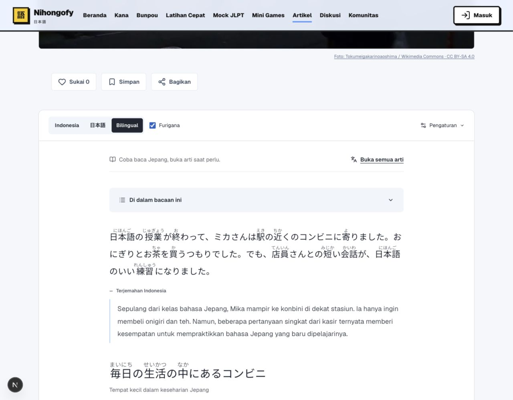
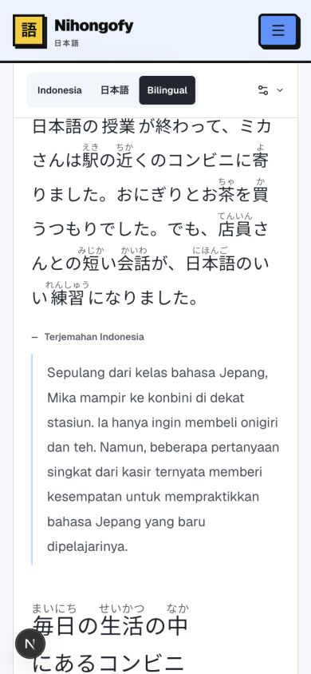

# Verifikasi modul artikel bilingual

Tanggal: 8 November 2026. Seluruh perubahan database pada sesi ini dilakukan di
PostgreSQL lokal terpisah (`nihongofy_article_20261108`), bukan Supabase production.
Preview memakai `http://localhost:3047` dengan override `FEATURES_ARTICLE=true`.
Konfigurasi `.env` workspace tidak diubah.

## Hasil pemeriksaan

| Pemeriksaan | Hasil |
|---|---|
| Prisma generate dan validate | Lulus |
| Replay migration pada database QA kosong | Seluruh 47 migration berhasil |
| Prisma migrate status setelah verifikasi | Up to date |
| Seed dan validasi fixture | Tepat 1 artikel, 18 blok, 12 kosakata, N4 |
| Lint | Lulus |
| Typecheck | Lulus, termasuk tahap TypeScript build produksi |
| Seluruh tes dengan PostgreSQL QA | 67 file, 839 tes lulus |
| Build produksi | Lulus, seluruh route selesai dihasilkan |
| Git diff --check | Lulus |

Database akhir berisi satu artikel `singgah-di-konbini`, tanpa akun, komentar,
interaksi, atau angka suka/tayangan buatan. Fixture pengujian dibersihkan setelah tes.
Seed idempoten berdasarkan slug; artikel lain dan interaksi yang sudah ada tidak
dihapus oleh script seed.

## Cakupan tes otomatis

- Validasi blok, identitas blok unik, level, slug route khusus, kelengkapan pasangan
  bahasa, terjemahan parsial pada draf, dan pencarian tanpa sintaks ruby.
- Penolakan non-admin, publikasi, revisi privat yang tidak mengubah versi publik,
  slug tetap setelah pernah terbit, dan pembatasan hapus artikel.
- Like idempoten saat retry/concurrent request, isolasi bookmark per akun, view
  sekali per akun, serta anonimisasi yang berjalan bersamaan dengan like.
- Komentar dan balasan mewarisi target artikel, ownership, tombstone, suspend,
  rate limit, diskusi ditutup, artikel diarsipkan, pin, dan permalink pagination.
- CHECK constraint, foreign key, RLS, serta tidak adanya grant Supabase Data API.

Tes integrasi memakai Prisma dan PostgreSQL nyata. Auth, invalidasi cache, Redis
rate limiter, serta layanan storage di-mock; tes ini tidak menggantikan UAT login
dan layanan eksternal. URL tes wajib diberikan secara eksplisit dan hanya menerima
database QA pada localhost. Tanpa URL ini sembilan tes integrasi dilewati.

```sh
ARTICLE_TEST_DATABASE_URL=postgresql://lanstheprodigy@localhost:5432/nihongofy_article_20261108 npm test
```

## Pemeriksaan browser

Browser QA menggunakan data seed yang sama. Yang diperiksa langsung:

- Katalog dan reader desktop; reader serta pencarian pada viewport 390 × 844.
- Mode Indonesia, Jepang, dan bilingual; terjemahan per blok dan semua arti;
  daftar isi menuju anchor bacaan.
- Furigana aktif/nonaktif; ukuran teks; latar gelap; tampilan sejajar desktop;
  preferensi bertahan setelah reload. Teks tetap terbaca pada latar gelap.
- Toolbar dan tombol interaksi mobile; tidak ada overflow horizontal pada lebar
  390 px. Furigana mobile tersedia lewat Pengaturan membaca.
- Pencarian `コンビニ` dengan N4, bilingual, kategori Kehidupan Sehari-hari, dan tag
  konbini menghasilkan satu artikel. Mengganti level menjadi N1 menghasilkan
  keadaan kosong dengan tautan untuk membersihkan filter.
- Checkbox tag melalui label yang terlihat serta panel filter yang dapat ditutup.
- Sukai/Simpan oleh tamu menampilkan ajakan login dengan return URL ke artikel.

Alur editor admin dan interaksi akun terautentikasi belum diuji manual di browser;
aturan servernya sudah dicakup tes integrasi. Login, upload R2, laporan melalui
Turnstile, dan moderasi end-to-end perlu UAT dengan akun pada staging.





## Penerapan ke environment lain

Belum ada deployment atau perubahan database production. Pada target yang sudah
dipilih, jalankan migration `20261108124838_article_bilingual_reader`, generate
Prisma Client dalam build, lalu seed dan aktifkan flag artikel.

```sh
npx prisma migrate deploy
npm run seed:articles:check
npm run seed:articles
```

Pastikan `DATABASE_URL` dan `DIRECT_URL` menunjuk target yang sama sebelum menjalankan
perintah database. Aktifkan `FEATURES_ARTICLE=true` di deployment. Setelah reseed pada
server yang sudah berjalan, invalidasi cache artikel lewat admin ops atau redeploy.
Lihat [modul artikel](../module/article.md) dan [ledger migration](../operations/migrations.md).
