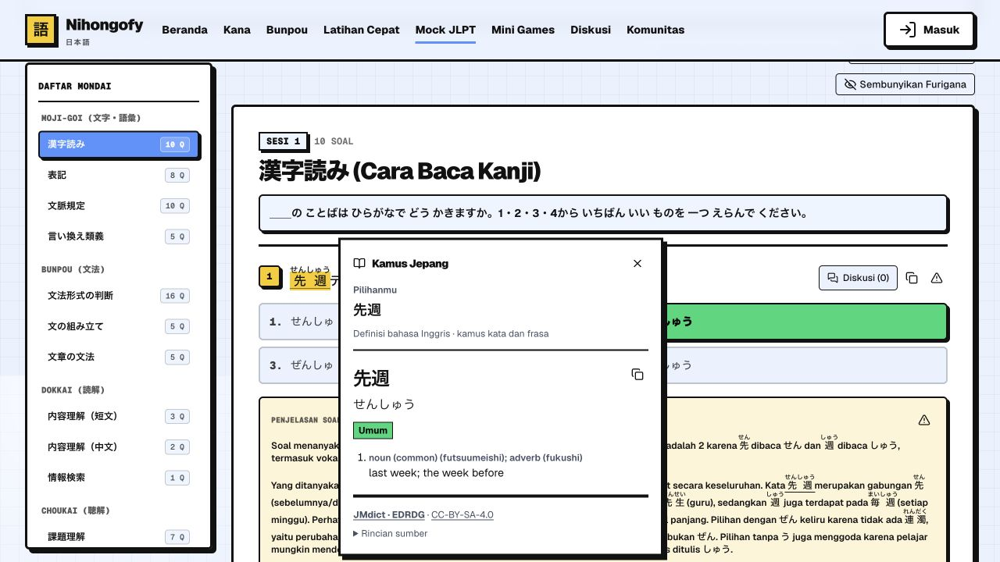
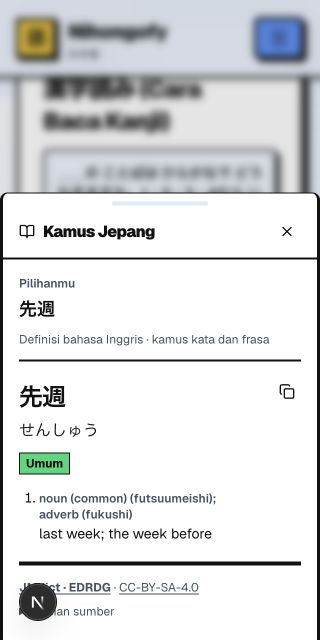

# Verifikasi dan UAT kamus seleksi

Tanggal: **18 Oktober 2026 (Asia/Jakarta)**. Tester lokal: Codex.
Perubahan: implementasi rencana commit `6ad9448`, belum di-commit/deploy oleh tugas ini.
Environment: macOS arm64, Node 20.19.6, Next 16.3.5, localhost:3000, browser Chromium in-app.
Viewport: 1280×720 dan 320×640. Akun: guest; contoh teks publik dan sesi flashcard ephemeral.
Flag hanya diaktifkan lewat environment proses lokal; file env aktif tidak diubah.

**Keputusan rilis: implementasi tersedia; pertahankan `FEATURES_DICTIONARY=false` untuk publik
sampai gate perangkat nyata dan hosting selesai.** Rujukan [modul](../module/dictionary.md),
[rencana](../plan/dictionary-popup.md), [runbook](../operations/dictionary.md).

## Gate otomatis

| Pemeriksaan | Hasil |
| --- | --- |
| `npm run verify` (lint, typecheck, seluruh Vitest, build) | PASS: lint 0 warning, TypeScript strict, 56 file / 724 test (termasuk answer-key guard existing), dan production build. |
| Test dictionary | PASS, 30 test: data penuh, input, batas kerja, urutan hasil, konjugasi, sense restriction, flag, limiter/cache, error, timeout/concurrency. |
| `dictionary:check` | PASS, seluruh 512 hash/ukuran/schema/referensi/restriction, 218.898 entri dan 465.832 term. |
| Rebuild offline di direktori disposable | PASS, seluruh 514 file (termasuk manifest/NOTICE) identik byte/hash dengan artefak yang dipublikasikan. |
| Update dengan SHA-256 salah | PASS, exit gagal sebelum publikasi; hash indeks valid sebelumnya tetap sama. |
| Trace server dan bundle client | PASS: tiga trace halaman (mode baca, try flashcard, bunpou) masing-masing memuat 512 shard unik + manifest/NOTICE (17.291.350 byte); 126 file JS client tanpa marker dataset/arsip/shard. [Evidence build](evidence/2026-10-18-dictionary-build.json). |

Checker tidak mengakses database/Redis. Test action memakai mock infrastruktur; uji UI melakukan
lookup sungguhan melalui Server Action dan Redis limiter existing dengan prefix QA lokal.
Tidak ada framework/dependency baru untuk pengujian.

## Hasil browser lokal

`PASS` hanya untuk langkah yang dijalankan. Fixture interaksi lokal memakai komponen yang sama
dan telah dihapus sebelum build; fixture tidak menambahkan route rilis.

| Skenario | Hasil aktual |
| --- | --- |
| Mode baca `/test-package/44/questions` | PASS: double-click ruby `先週` memberi `せんしゅう`, “last week; the week before”, common dan sumber. Fokus tidak diambil otomatis, native selection tetap tersedia. |
| Drag ruby + underline | PASS pada fixture: native selection `食たべました` diproyeksikan menjadi `食べました`; hasil `食べる/たべる` dengan label sopan/lampau dan arti “to eat”. |
| Furigana terlihat/hidden | PASS pada fixture dan mode baca: kueri dasar tetap sama; toggle menutup popup. Invisible dan line wrap beragam masih NOT RUN. |
| Escape dan seleksi ulang | PASS: Escape menutup, seleksi lama tidak otomatis membuka lagi; double-click baru pada kata yang sama dapat membuka kembali. |
| Alt+K | PASS pada fixture: fokus berpindah ke tombol Tutup kamus. |
| Perubahan seleksi keyboard | PASS terbatas: Shift+Arrow mengubah rentang; ekspansi ke paragraf lain menutup popup. Cakupan keyboard lintas browser masih NOT RUN. |
| Preferensi off/on | PASS: off menandai region nonaktif dan seleksi tidak membuka UI; on memungkinkan seleksi baru. Preference storage-denied masih NOT RUN. |
| Lintas sel/paragraf | PASS pada fixture: drag `読む\t書く` lintas dua sel dan seleksi keyboard lintas paragraf tidak membuka popup. |
| Composer | PASS: textarea pada sheet tetap menerima fokus dan tidak membuka kamus. Contenteditable dan input lain masih NOT RUN secara manual. |
| Context/reveal gate generik | PASS pada fixture: seleksi `日本語` tidak aktif sebelum reveal; aktif sesudahnya; pergantian konteks menutup popup. |
| Flashcard `/flashcard/try/n5` | PASS: sebelum reveal region false; reveal membersihkan seleksi sisi depan; contoh `日本` dapat dicari setelah reveal. |
| Shortcut flashcard | PASS: 1–4, Space, Enter dan F saat popup aktif tidak mengubah kartu/progres atau menutup popup lewat native scroll/activation. Klik tombol Good tetap menilai sesi ephemeral, menutup popup, membersihkan seleksi, dan kartu berikutnya kembali tanpa kamus. |
| Sheet dan urutan Escape | PASS pada fixture: portal kamus berada di dialog sumber; Escape menutup kamus terlebih dahulu dan sheet tetap terbuka; Escape berikutnya menutup sheet. |
| Clipboard | Feedback sukses terlihat ketika Salin ditekan. Isi clipboard tidak dikonfirmasi independen oleh adapter; penolakan permission masih NOT RUN. |
| Drawer 320 px | PASS terbatas: seleksi memberi aksi Kamus, klik membuka drawer; bounding box kiri 0/kanan 320, tombol tutup dan hasil dapat dibaca. Escape mengembalikan fokus ke region sumber. Ini bukan simulasi native selection toolbar iOS/Android. |
| Build produksi lokal | PASS: `next start` flag true memuat lookup `先週` lewat action sungguhan setelah refactor provider; console tanpa warning/error aplikasi. Flag false menghilangkan region/control dan seleksi tidak membuka popup. Tab dari flag true yang masih terbuka menerima “Kamus seleksi belum tersedia” ketika mencari kata baru setelah server dimatikan flagnya. |
| Browser console | Tidak ada error aplikasi baru pada pemeriksaan akhir; warning Fast Refresh selama pengembangan. |

Bukti halaman sebenarnya:

## Bukti kapasitas lokal

[Evidence JSON](evidence/2026-10-18-dictionary.json) memuat versi, provenance, 13 kueri publik,
ukuran response, metrik reader, memori, dan latency. Artefak gzip 17.209.096 byte,
JSON terdekompresi 100.384.580 byte; manifest 81.374 byte.

Pada run lokal ini: seri pertama p50 **23,79 ms**, p95 **241,75 ms**; seri kedua p50
**15,54 ms**, p95 **178,05 ms**. Keduanya mengukur filesystem+gunzip+proyeksi dalam satu proses,
termasuk churn LRU; tidak memasukkan Redis, network, Next Data Cache, atau cold start deployment.
LRU akhir diperkirakan 16.758.885 byte. RSS sebelum/sesudah sekitar 143/298 MB, tetapi proses
juga baru melakukan validasi seluruh dataset dan memiliki alokasi sementara yang belum di-GC;
angka ini bukan ukuran memori steady-state server ataupun jaminan batas memori hosting.

## Gate manual sebelum aktivasi

Isi hasil bersama perangkat/browser, akun/data, evidence dan tanggal. Gate ini mengikuti
[checklist pengujian manual](manual-test-checklist.md) dan acceptance pada rencana.

| Skenario tersisa | Status / owner |
| --- | --- |
| Safari iOS dan Chrome Android nyata: long-press, ubah gagang, native Copy toolbar, aksi Kamus tidak menghalangi, drawer swipe/backdrop, focus return | NOT RUN — QA/Release Owner |
| Zoom 200%, light/dark, reduced motion, pembaca layar dan navigasi Tab menyeluruh | NOT RUN — QA |
| Ruby invisible, slot/sorotan/line wrap, seleksi 40/41 code point, Latin/kosong, input/contenteditable pada semua renderer | Parsial otomatis/lokal; UAT lengkap NOT RUN — QA |
| Practice guest/login: belum submit, submit pending/gagal, konfirmasi server, next/back, passage bersama, transkrip ditutup | NOT RUN secara browser — QA |
| Reviewer login: rating persisten, undo/restart, catatan privat; semua input/edit dan sheet diskusi asli | NOT RUN — QA |
| Kotoba Clash pemain/spectator: menjawab awal, phase/round change, timer, reconnect dan review hasil | NOT RUN secara pertandingan — QA |
| Guest/login/akun A/B: review detail, bunpou/compare, vocab discussion, body artikel dan komentar sesuai izin existing | NOT RUN menyeluruh — QA |
| Jaringan lambat/terputus, respons terbalik, close selama request, indeks hilang/rusak, busy/rate limit/retry dan clipboard ditolak di UI | Action failure/timeout/capacity diuji otomatis; UAT jaringan/UI NOT RUN — Engineering/QA |
| Flag off pada server hidup/tab lama dan flag modul induk | PASS untuk action off, UI off dan tab lama pada build produksi lokal; flag modul induk menyeluruh NOT RUN — Engineering/QA |
| Paket deployment, cold start, RSS peak/concurrency 1/8, p50/p95 hit/miss, kuota/biaya Redis dan error/timeout rate di hosting target | NOT RUN — Engineering/Release Owner |

## Migration dan keputusan

- Status migration: **not required**; migration: tidak ada.
- Schema/data aplikasi existing: tidak berubah; tidak ada query migration, seed, backfill, atau
  perubahan grant/RLS. Data baru hanya artefak kamus read-only di repository.
- Refresh: restart/redeploy untuk perubahan flag atau indeks, lalu refresh tab; tidak perlu
  flush Redis global atau seed DB. Update indeks harus satu deployment utuh sesuai runbook.
- Known defect terkonfirmasi pada fitur setelah perbaikan lokal: tidak ada yang masih terbuka.
  UAT yang belum dijalankan tidak dianggap PASS.

| Gate | Severity | Owner | Keputusan |
| --- | --- | --- | --- |
| Native selection mobile dan aksesibilitas lintas browser belum diterima | P1 gate aktivasi | QA/Release Owner | Tetap default-off sampai bukti lengkap. |
| Budget paket function, cold start, RSS dan Redis target belum diukur | P1 gate aktivasi | Engineering/Release Owner | Benchmark lokal tidak menggantikan pengukuran target. |
| Flow login/practice/game dan gangguan jaringan belum di-UAT menyeluruh | P1 gate aktivasi | QA | Jalankan matriks di atas pada preview sebelum aktivasi. |

Tidak ada deployment, aktivasi production, automation update bulanan, atau commit yang dilakukan
oleh tugas implementasi ini.
